<p align="center">
  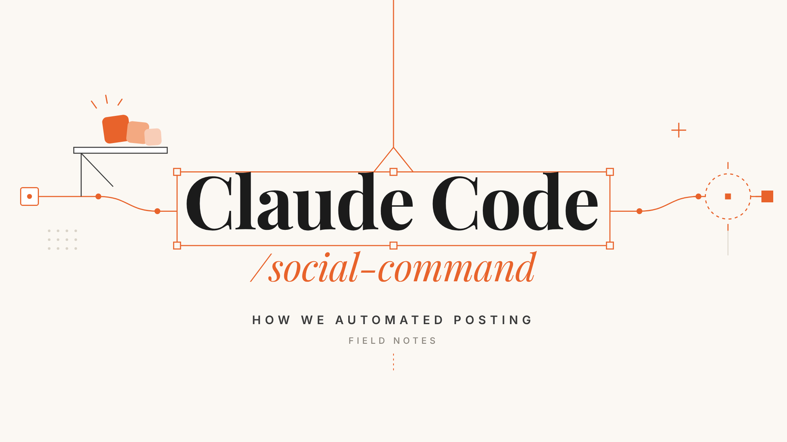
</p>

<h1 align="center">Social Command</h1>

<p align="center">
  <b>Give Claude Code a social media team.</b><br>
  Say <code>post launch.mp4 everywhere, thursday 10am</code> and Claude checks the file, writes four captions, makes the cover and books the post on YouTube, Instagram, Facebook, LinkedIn and X.<br>
  Nothing goes out until a person presses <b>Approve</b>, and every post reports its numbers back an hour later.
</p>

<p align="center">
  <a href="LICENSE"></a>
  
  
  
  
</p>

<p align="center">
  <a href="#quick-start">Quick start</a> ·
  <a href="#how-it-works">How it works</a> ·
  <a href="#a-tour-of-the-dashboard">Tour</a> ·
  <a href="#post-from-claude">Post from Claude</a> ·
  <a href="#configuration">Configuration</a> ·
  <a href="#faq">FAQ</a>
</p>

<picture>
  <source media="(prefers-color-scheme: dark)" srcset="docs/images/home-dark.png">
  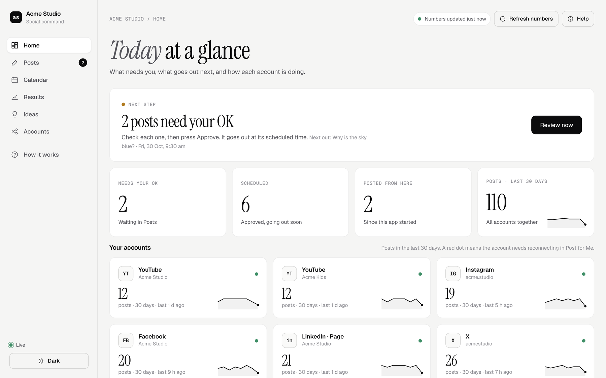
</picture>

<p align="center"><sub>Every screenshot here is a demo team ("Acme Studio") with made-up numbers. Images follow your GitHub light or dark theme.</sub></p>

## What you get

- 🎬 **One sentence to a finished post.** Claude Code inspects the video (ffprobe), re-encodes if needed, writes a YouTube title plus captions for Instagram/Facebook, X and LinkedIn within each platform's limits, and makes a cover in the same shape as the video.
- ✅ **An approval queue.** Every post waits under **Needs your OK** until someone checks it and presses Approve or Publish now. Send it back to Claude with a note for a rewrite.
- 🗓️ **A calendar** of the next two weeks across every account, so two people never book on top of each other.
- 📈 **Results that come back by themselves**: views, likes, comments, shares, impressions, watch minutes and subscribers from every account, refreshed every hour, with daily snapshots for trends.
- 💡 **Ideas from your own numbers.** Claude reads the results and suggests what to post next, lane by lane, with the evidence next to each claim.
- 🔁 **Retries that don't double-post.** A post that fails on one account is re-sent only there. YouTube's daily upload limit is waited out and retried after the reset.
- 🧩 **Carousels, PDFs as image carousels, stories, 9:16 ⇄ 16:9 cuts made in the browser,** and big files up to 200 MB.
- 🤖 **A Claude connector** (MCP) so anyone on the team can post from a Claude chat, and a **skill** for Claude Code.

## How it works

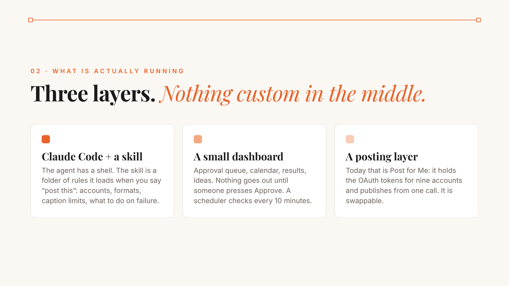

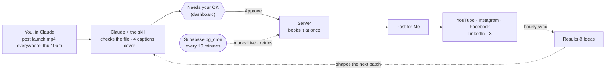

| Piece | Where | What it does |
|---|---|---|
| `public/index.html` | Vercel (static) | The dashboard: Home, Posts, Calendar, Results, Ideas, Accounts, How it works |
| `public/shim.js` | Vercel (static) | Sign-in (email link), live document store and uploads on Supabase |
| `api/publish.js` | Vercel function | Sends an approved post to Post for Me: booked, or right now for Publish now |
| `api/cron.js` | Vercel function | The background loop: sends waiting posts, marks posts Live, retries, syncs numbers hourly |
| `api/mcp/[key].js` | Vercel function | The Claude connector (MCP): list accounts, upload, add, publish, delete posts |
| `api/agent.js` | Vercel function | Claude's API for scheduled runs: read, draft and edit, never approve or publish |
| `lib/` | Server code | Publishing, Post for Me client, sync and insights, auth |
| `supabase/schema.sql` | Supabase | One `docs` table, team-only access rules, live updates, media bucket |
| `supabase/cron.sql` | Supabase | pg_cron + pg_net: calls `/api/cron` every 10 minutes, secrets kept in Vault |
| `skills/social-command-post/` | Claude Code | The skill: accounts, file rules, caption rules, cover rules, what to do on failure |

### One post, start to finish

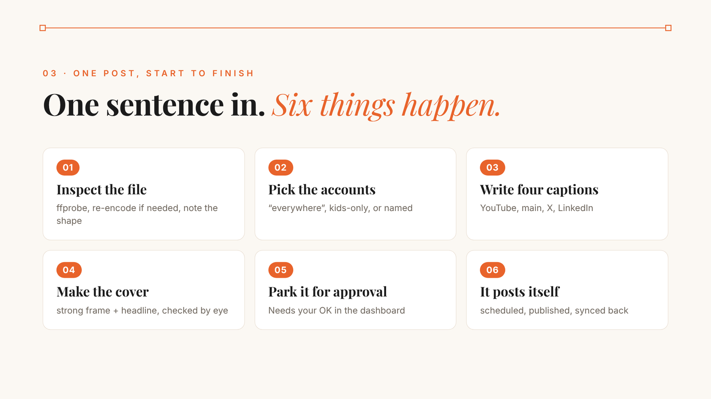

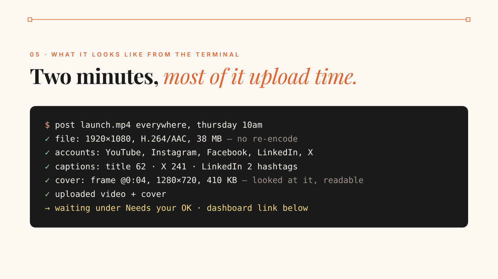

## A tour of the dashboard

**Posts: the approval queue.** Every post has a coloured dot: Needs your OK, Claude is finishing, Back with Claude, Approved, Scheduled, Live, Didn't go out, Discarded. Pick the accounts, check the captions and the cover, set the time, press Approve.

<picture>
  <source media="(prefers-color-scheme: dark)" srcset="docs/images/posts-dark.png">
  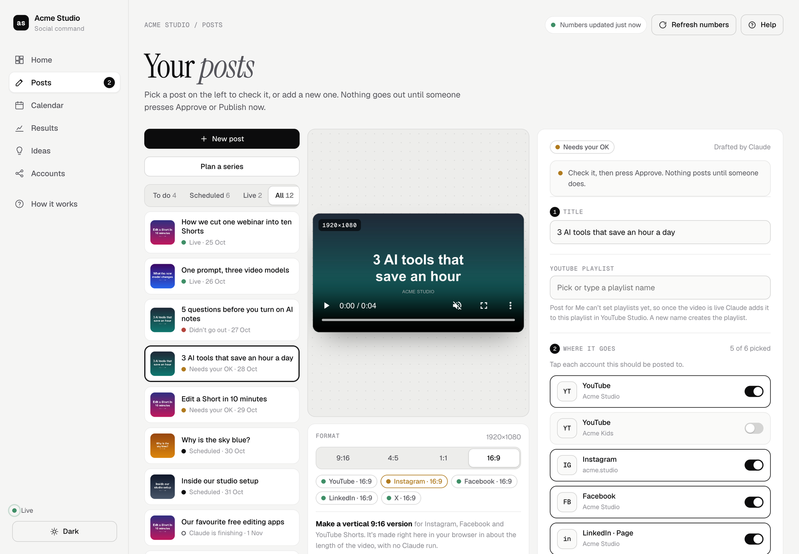
</picture>

**Calendar: the next two weeks.** Filled cards are posts from the app; outlined cards already went live on the accounts.

<picture>
  <source media="(prefers-color-scheme: dark)" srcset="docs/images/calendar-dark.png">
  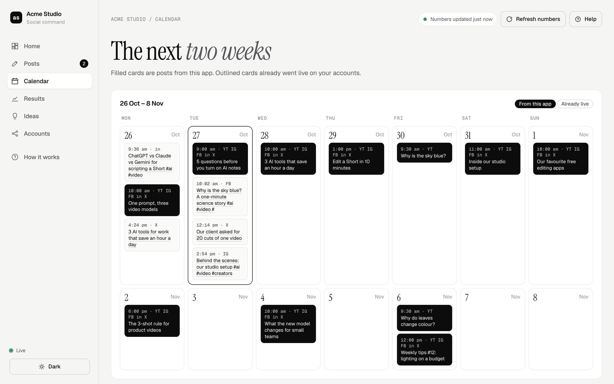
</picture>

**Results: numbers from every account, every hour.** It says plainly when a platform isn't sharing a number yet, rather than showing a zero.

<picture>
  <source media="(prefers-color-scheme: dark)" srcset="docs/images/results-dark.png">
  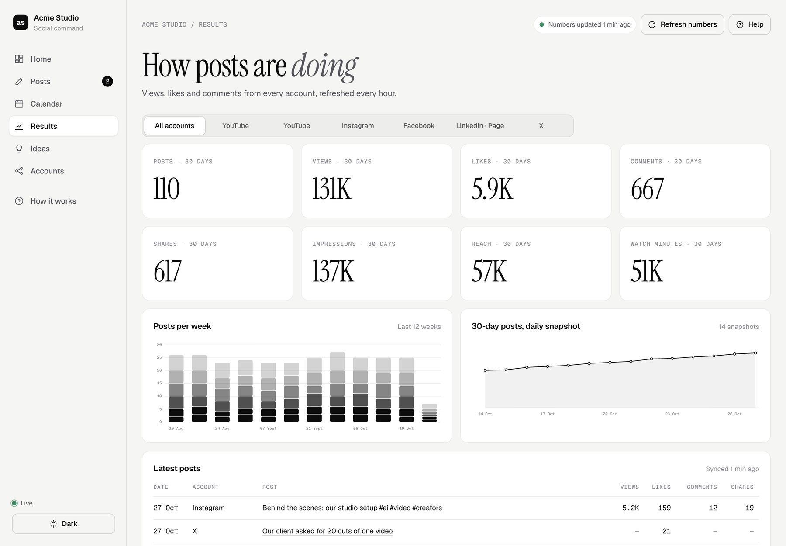
</picture>

**Ideas: what to post next.** Claude's read of your own numbers, plus trending topics it can draft into a post for you.

<picture>
  <source media="(prefers-color-scheme: dark)" srcset="docs/images/ideas-dark.png">
  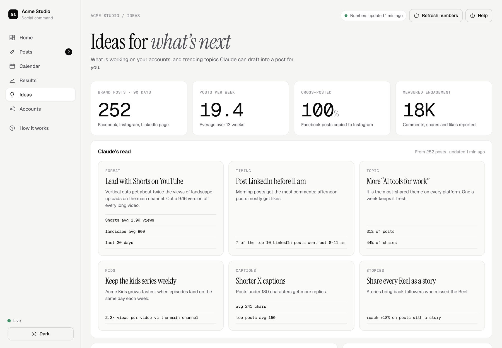
</picture>

<details>
<summary><b>More screenshots</b>: a post that didn't go out, the accounts page, connecting Claude</summary>
<br>

**A post that didn't go out** shows the reason and the fix. Approve again and it is re-sent only where it failed.

<picture>
  <source media="(prefers-color-scheme: dark)" srcset="docs/images/post-failed-dark.png">
  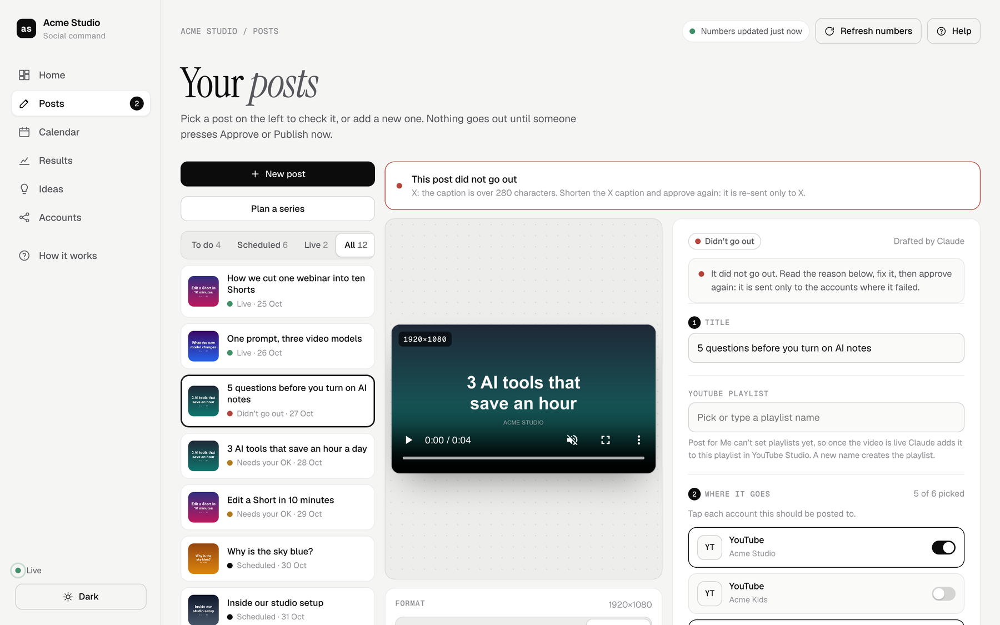
</picture>

**Accounts** lists every connected account, what it reports, and its best formats.

<picture>
  <source media="(prefers-color-scheme: dark)" srcset="docs/images/accounts-dark.png">
  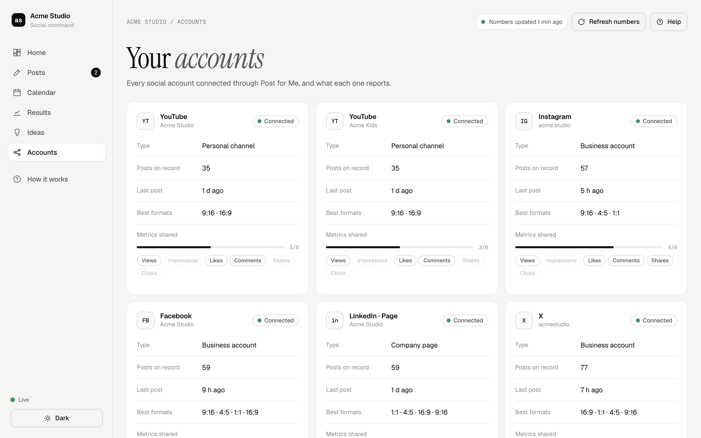
</picture>

**How it works → Connect Claude** gives each teammate the connector link.

<picture>
  <source media="(prefers-color-scheme: dark)" srcset="docs/images/connect-claude-dark.png">
  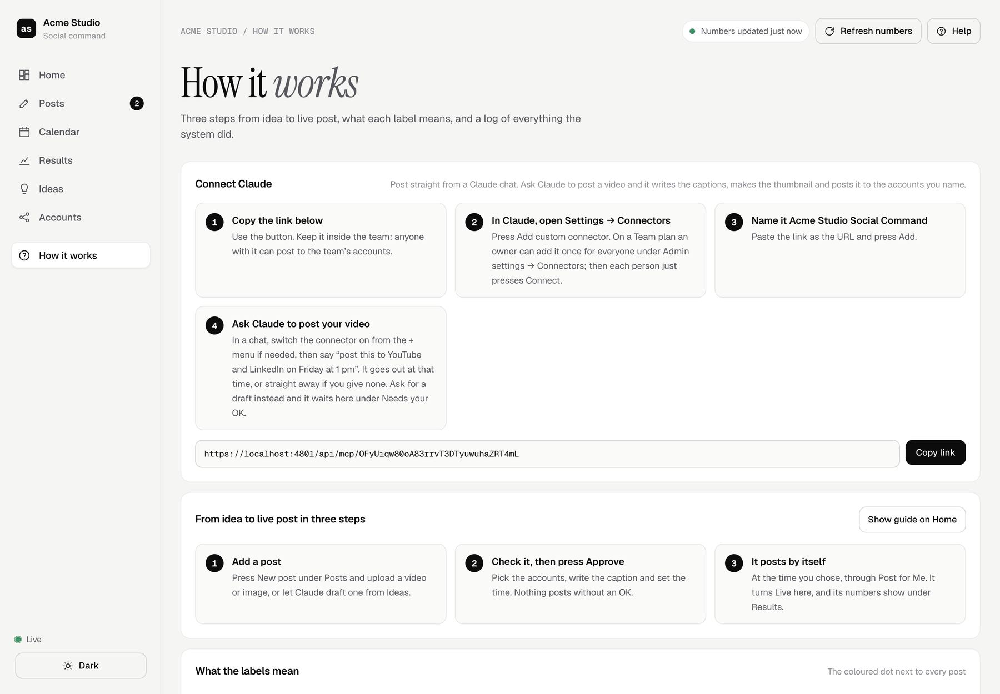
</picture>

</details>

## Quick start

About 30 minutes. You need free accounts on [Supabase](https://supabase.com) and [Vercel](https://vercel.com), a [Post for Me](https://postforme.dev) account with your social accounts connected, and (to post from chat) [Claude](https://claude.ai).

[](https://vercel.com/new/clone?repository-url=https%3A%2F%2Fgithub.com%2Fsanket-fls%2FSocial-Tracker&project-name=social-command&repository-name=social-command&env=SUPABASE_URL,SUPABASE_ANON_KEY,SUPABASE_SERVICE_ROLE_KEY,PFM_KEY,CRON_SECRET,AGENT_TOKEN&envDescription=Keys%20from%20Supabase%20and%20Post%20for%20Me%2C%20plus%20two%20long%20random%20strings&envLink=https%3A%2F%2Fgithub.com%2Fsanket-fls%2FSocial-Tracker%23configuration)

Or clone it:

```bash
git clone https://github.com/sanket-fls/Social-Tracker.git social-command
```

<details>
<summary><b>1. Post for Me: connect your accounts</b></summary>
<br>

1. Sign up at [postforme.dev](https://postforme.dev) and connect each social account (YouTube, Instagram, Facebook, LinkedIn, X).
2. Create an API key. That is `PFM_KEY`. It only ever lives in Vercel's environment variables; it never reaches the browser or Claude.

</details>

<details>
<summary><b>2. Supabase: the database</b></summary>
<br>

1. Create a project at [supabase.com](https://supabase.com).
2. Open `supabase/schema.sql` and change `'%@yourcompany.com'` to your team's email domain (people outside it can be added later).
3. **SQL Editor → New query →** paste the whole file → **Run**.
4. **Authentication → URL Configuration:** set *Site URL* to your Vercel address and add it under *Redirect URLs* (you can come back to this after step 3).
5. **Project Settings → API:** copy the *Project URL*, the *anon* key and the *service_role* key.

</details>

<details>
<summary><b>3. Vercel: the app</b></summary>
<br>

1. Use the **Deploy with Vercel** button above, or **Add New → Project →** import your fork (framework preset: *Other*).
2. Add the environment variables from [Configuration](#configuration). Make `CRON_SECRET` and `AGENT_TOKEN` long random strings:
   ```bash
   openssl rand -hex 32
   ```
3. Deploy, open the address Vercel gives you, and sign in with a work email (a sign-in link arrives by email).

</details>

<details>
<summary><b>4. The 10-minute loop (Supabase pg_cron)</b></summary>
<br>

1. Supabase → **Integrations → Vault → Add new secret**, twice:
   - `social_tracker_cron_secret`: the same value as `CRON_SECRET` on Vercel
   - `social_tracker_app_url`: your app's address, e.g. `https://your-app.vercel.app`
2. **SQL Editor →** paste `supabase/cron.sql` → **Run**. It calls `/api/cron` every 10 minutes and once straight away; **How it works → Run log** shows "first run from the Supabase scheduler" within a minute.

Optional backup: `docs/github-actions/tick.yml` calls the loop from GitHub Actions. Copy it to `.github/workflows/tick.yml`, add the repository secrets `APP_URL` and `CRON_SECRET`, and uncomment its `schedule`.

</details>

<details>
<summary><b>5. Connect Claude</b></summary>
<br>

See [Post from Claude](#post-from-claude) below. Each teammate adds one link once.

</details>

## Post from Claude

**The connector (any Claude app).** In the dashboard, open **How it works → Connect Claude** and copy the link. In Claude: **Settings → Connectors → Add custom connector**, name it *Social Command*, paste the link. On a Team plan an owner can add it once for everyone. Then just ask:

> post this to YouTube and LinkedIn on Friday at 1 pm

Claude lists the accounts, uploads the video and the cover, writes the captions and adds the post. When you ask it to post, it goes out at that time (or straight away); ask for a draft and it waits under **Needs your OK**. The link's key is derived from `AGENT_TOKEN` (or set `MCP_KEY`), so treat the link like a password.

**The skill (Claude Code).** Copy `skills/social-command-post/` into `~/.claude/skills/` (or your project's `.claude/skills/`), replace `YOUR-APP.vercel.app`, and fill in your accounts and rules. Claude Code loads it the moment someone says "post this".

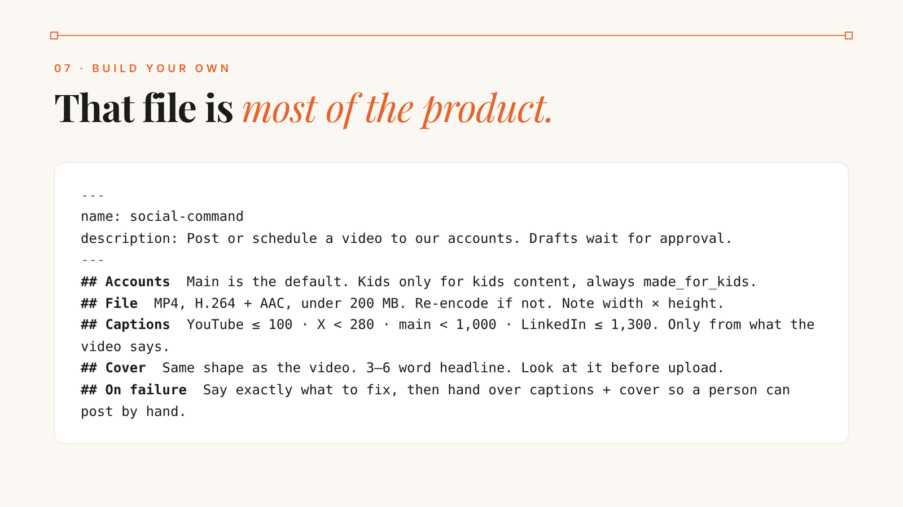

**A scheduled Claude (optional).** `docs/claude-task-prompt.md` is a prompt for a Claude Code routine that refreshes the recommendations, drafts posts from trending topics and finishes the covers and captions the team asks for. Set `CLAUDE_ROUTINE_URL` and `CLAUDE_ROUTINE_TOKEN` and **Publish now** starts it straight away.

## The rules that make it boring

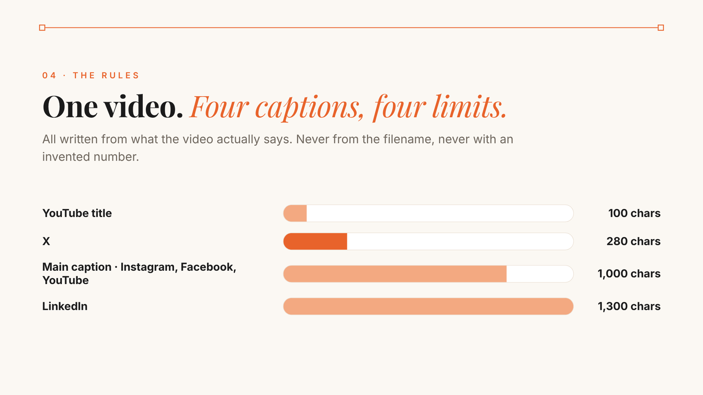

| Rule | Why it exists |
|---|---|
| Captions come from the video, never from the filename | A made-up number on LinkedIn is worse than no post |
| Four captions, four limits, one voice | X cuts at 280, LinkedIn tolerates 1,300, YouTube titles stop at 100 |
| The cover is the same shape as the video | A 16:9 cover on a Short looks broken on every phone |
| Claude looks at the cover before uploading | Text on a busy frame is unreadable; a look catches it |
| Kids content goes to the kids channel only, flagged made-for-kids | The wrong channel or a missing flag is a policy problem, not a typo |
| YouTube uploads are spread across days | YouTube has a daily cap; the dashboard retries after the reset, only where it failed |
| Nothing goes out without Approve | Checking should be one click, not a re-run |

## Configuration

Set these on Vercel (**Project → Settings → Environment Variables**). `.env.example` has the same list.

| Variable | Needed | What it is |
|---|---|---|
| `SUPABASE_URL` | ✅ | Supabase *Project URL* |
| `SUPABASE_ANON_KEY` | ✅ | Supabase *anon* key (safe in the browser; row-level security protects the data) |
| `SUPABASE_SERVICE_ROLE_KEY` | ✅ | Supabase *service_role* key, server only |
| `PFM_KEY` | ✅ | Post for Me API key, server only |
| `CRON_SECRET` | ✅ | Long random string; the same value goes in Supabase Vault |
| `AGENT_TOKEN` | ✅ | Long random string: Claude's API key, and the seed of the connector link |
| `TEAM_NAME` | | Your team's name in the dashboard and the connector, e.g. `Acme Studio` |
| `POSTING_RULES` | | Plain sentences for Claude about which accounts to use, e.g. `"Everywhere" means the Acme accounts. Kids content goes to Acme Kids only.` |
| `PFM_EXCLUDE` | | Post for Me account ids to leave out, comma-separated |
| `OPEN_ACCESS` | | `1` = no sign-in: anyone with the link can approve and publish. Leave empty for team sign-in |
| `MCP_KEY` | | A fixed connector key instead of one derived from `AGENT_TOKEN` |
| `CLAUDE_ROUTINE_URL`, `CLAUDE_ROUTINE_TOKEN` | | Start your Claude routine when someone presses Publish now on a post Claude still has to finish |

**Team access.** Anyone whose email matches a pattern in `team_emails` can sign in. To add someone outside your domain, run in the SQL editor:

```sql
insert into team_emails (pattern) values ('person@example.com');
```

**Make it yours.** Set `TEAM_NAME` and `POSTING_RULES`, rewrite the skill's accounts and voice, and edit the themes the Ideas page groups posts by in `lib/sync.js` (they are tuned for AI and creator content).

## Limits and good to know

- **Times are India Standard Time (IST)** throughout the dashboard and the connector. Supporting other time zones is a welcome contribution.
- **Uploads:** up to 50 MB on Supabase's free plan. Bigger files, up to 200 MB, go straight into Post for Me's storage, so no Supabase upgrade is needed. On Supabase Pro, raise the `media` bucket's limit and everything follows it.
- **Vercel functions** run up to 300 seconds, enough to hand a 50 MB video to Post for Me. Vercel's free plan allows one cron a day, which is why the 10-minute loop runs in Supabase.
- **YouTube's daily upload limit** through Post for Me is shared with its other customers. A post refused for it is retried just after midnight Pacific, only on the accounts that failed.
- **YouTube playlists** can't be set through Post for Me; posts with a playlist are flagged `needs_playlist` once live.
- **How it works → Behind the scenes** shows when the loop last ran; the dot turns amber after 30 quiet minutes.

## Local checks

```bash
npm install
PFM_KEY=... npm run check   # read-only: pulls every feed from Post for Me and prints what a sync would write
```

## FAQ

<details>
<summary><b>Do I have to use Post for Me?</b></summary>
<br>

No. It is the cheapest part of the stack and solved the ugliest problem on day one: holding and refreshing OAuth tokens for many accounts and exposing one publish call. Every platform has its own publishing API (YouTube Data API, Meta Graph API for Instagram and Facebook, LinkedIn Posts API, X API v2). Going direct means five OAuth flows and five sets of rate limits to handle, and nothing else changes: the skill and the dashboard stay the same, only the last call in `lib/publish.js` does.

</details>

<details>
<summary><b>Can Claude post without a person approving?</b></summary>
<br>

Only when a person asks it to in the chat ("post this now", "post it Friday at 1 pm"), through the connector. Claude's scheduled runs use `AGENT_TOKEN`, which can draft and edit but never approve, schedule or publish. Anything asked for as a draft waits under **Needs your OK**.

</details>

<details>
<summary><b>Can I delete a post after it is booked?</b></summary>
<br>

Yes, until it goes live: **Delete** takes it out of Post for Me too. Once it is live, remove it on the platform itself.

</details>

<details>
<summary><b>Is it safe to share the dashboard link?</b></summary>
<br>

With team sign-in (the default), only people on your `team_emails` list get in. With `OPEN_ACCESS=1`, anyone with the link can approve and publish to every connected account. The Post for Me key, the Supabase service key and `AGENT_TOKEN` stay on the server.

</details>

## License

[MIT](LICENSE) © 2026 Futurelab Studios.

Bundled in `public/vendor/`: [supabase-js](https://github.com/supabase/supabase-js) (MIT), [PDF.js](https://github.com/mozilla/pdf.js) (Apache-2.0) and [mp4-muxer](https://github.com/Vanilagy/mp4-muxer) (MIT), each under its own license.

<p align="center"><sub>Built with Claude Code.</sub></p>
